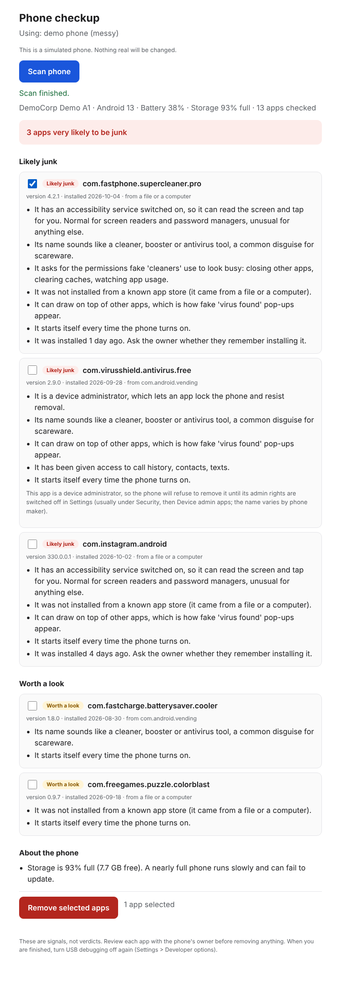

# phonecheck

A read-only junk-app and health checkup for Android phones, over USB. Plug a phone in, get a plain-English report of which apps look like scareware and why, and remove the ones you choose.



## Why

In phone retail, customers regularly hand over a phone and say "can you check if anything is wrong with it?" The usual culprits are fake "cleaner", "booster" and "antivirus" apps that exist to make a phone look infected. Finding them by hand means opening Settings, scrolling through every app, and uninstalling them one at a time, several times a day.

phonecheck does the looking. It reads what Android will share over USB, scores each app on observable behaviour, and explains every flag in words a customer can follow. It never deletes anything on its own.

## Try it in 30 seconds (no phone needed)

Requires Python 3.10+. There are no dependencies to install.

```bash
git clone <this repo> && cd phonecheck
pip install -e .

phonecheck scan --demo messy          # a synthetic phone full of junk
phonecheck scan --demo clean          # a healthy one
phonecheck remove --demo messy        # walk through the removal flow, safely simulated
phonecheck serve --demo messy         # the same thing as a web page
```

The demo phones are invented ("DemoCorp"), generated by `tools/make_demo_phones.py`, and contain no real data.

## With a real phone

1. Install Android [platform-tools](https://developer.android.com/tools/releases/platform-tools) so `adb` is on your PATH.
2. On the phone: Settings > About phone > tap *Build number* seven times, then Settings > Developer options > turn on *USB debugging*. Plug in and tap *Allow* on the prompt.
3. Run:

```bash
phonecheck devices                    # is the phone visible and authorised?
phonecheck scan                       # print the report
phonecheck scan --format html         # save a page you can show the customer
phonecheck remove                     # choose apps to remove (asks twice)
phonecheck serve                      # local web page: click Scan, tick apps, confirm
```

Turn USB debugging off again when you are done. The tool reminds you.

## What it reads, and what it never touches

Reads (all via standard `adb shell` commands): the model and Android version, battery level/health/temperature, storage usage, the list of **user-installed** apps, and for each one its installer, version, install date, requested and granted permissions, whether it can draw over other apps, whether it has an accessibility service on, and whether it is a device administrator.

Never reads: contacts, messages, photos, call history, accounts, the phone number, serial number or IMEI. System apps are skipped entirely.

Changes: nothing, except when you run `remove` (or press the button in `serve`) and confirm. See [Safety](#safety).

## How it decides

Each rule is a small function that returns points and a reason written for the customer. An app's score is the sum.

| Rule | Points | Plain-English reason |
|---|---|---|
| `known_junk` | 8 | On your list of known-junk packages |
| `accessibility_service` | 4 | Can read the screen and tap for you |
| `device_admin` | 4 | Can lock the phone and resist removal |
| `junk_name` | 3 | Name sounds like a cleaner/booster/antivirus |
| `not_from_store` | 2 | Not installed from a known app store |
| `overlay` | 2 | Can draw on top of other apps (fake "virus found" pop-ups) |
| `cleaner_permissions` | 2 | Asks for the permissions fake cleaners use to look busy |
| `sensitive_access` | 2 | Has access to 3+ of: texts, contacts, call history, microphone, calls |
| `boot_start` | 1 | Starts itself every time the phone turns on |
| `recently_installed` | 1 | Installed in the last 7 days |

Score 6 or more is **likely junk**; 3 to 5 is **worth a look**; below 3 is not reported. A junk-sounding name alone (3 points) can never reach "likely junk": it takes behaviour to get there. Why a points system rather than something fancier is in [DECISIONS.md](DECISIONS.md).

Two details worth knowing:

- Well-known apps (`data/trusted_apps.txt`) are skipped, **but only when installed from a real store**. A sideloaded app that merely reuses a famous package name is still scored. The demo phone includes one.
- `data/known_junk.txt` ships empty on purpose. It is where in-person knowledge goes: when you meet a new fake cleaner, add its package name and every future scan flags it. Pass extra lists with `--junk-list` / `--trusted-list`.

## Safety

- **Nothing is preselected.** `remove` shows what it found, asks which numbers you want, then makes you type `remove`. There is no `--yes` flag.
- **Only user-installed apps can be targeted.** Before removing anything it re-reads the phone's current user-app list and refuses any package not on it, so system apps and typos are impossible to hit. If any requested package is refused, none are removed.
- **Phone output can never become a command.** Every argument sent to the phone is checked against a strict character allowlist, and package names must match Android's naming rules.
- **The web page is locked down.** It listens on `127.0.0.1` only, checks the `Host` header (DNS rebinding), requires a random per-run token (CSRF), accepts only JSON, sends no CORS headers and a strict Content-Security-Policy, and inserts text from phones into the page as text, never HTML. Each of these has a test.
- **Device-administrator apps** refuse to uninstall. The tool says so and explains how to switch their rights off first.

## Architecture

```
            cli.py ─────────── server.py + web/        (two front ends)
               │                      │
               └──────────┬───────────┘
                          ▼
   collector.py ──► rules.py ──► report.py              (read, decide, explain)
        │                │
        ▼                └──► removal.py                (the only code that changes a phone)
   parsers.py
        │
        ▼
     adb.py:  AdbDevice | FixtureDevice | RecordingDevice   (one tiny interface)
```

Everything above `adb.py` only sees a two-method interface (`shell`, `uninstall`). A real phone, a folder of recorded output, and a recorder that saves a phone's answers are interchangeable, which is why the whole tool is testable and demoable without hardware.

```
src/phonecheck/
  adb.py        talk to a phone (and replay/record one); shell-argument allowlist
  parsers.py    raw adb text -> data (pure functions, tolerant of odd output)
  collector.py  decide which commands to run; build a Snapshot
  rules.py      the rule engine; thresholds; device-level notes
  report.py     text / HTML / JSON output (HTML is escaped, script-free)
  removal.py    guarded uninstall
  cli.py        commands: devices, scan, remove, capture, serve
  server.py     localhost web server and its defences
  web/          the single-page interface (plain HTML, CSS, JS; no build step)
  data/         trusted-apps and known-junk lists
  demo_data/    the two synthetic demo phones
tools/          regenerate the demo phones and the screenshot
tests/          270+ tests
```

## Testing

```bash
pip install -e ".[dev]"
pytest
```

The suite covers the parsers (including malformed input), the shell-argument allowlist, every rule and the scoring thresholds, trust/spoofing behaviour, removal refusals, all CLI paths, report escaping, and every web security check over real HTTP. Real-browser tests (Playwright; they skip themselves if it isn't installed: `pip install -e ".[e2e]" && playwright install chromium`) click through the page and confirm that hostile text from a phone is displayed rather than executed.

A test also regenerates the demo phones and fails if the committed copies have drifted from the generator.

### Status

So far it has been verified against recorded and synthetic phone output. The parsers target the commonly documented `adb`/`dumpsys` formats, but manufacturers vary. If a real phone prints something a parser doesn't understand, run `phonecheck capture --out DIR` and use the saved files to add a parser fix and a test. Do not publish captures from other people's phones: they list every installed app.

## Limitations

- **Android only.** iPhones do not allow this kind of inspection or removal.
- **USB debugging must be on**, which takes a minute in Settings and should be switched off afterwards.
- **Heuristics, not verdicts.** A legitimate security app can look like scareware (it will often have overlay and accessibility rights), and a well-disguised bad app can score low. That is why everything is explained and nothing is automatic.
- **Not an antivirus.** It does not scan app code or match malware signatures.
- **Package names, not friendly names.** The report shows `com.example.app`, not an icon or title.

## Ideas for next

Show app names and icons; add rules from real-world cases as they turn up; ship a single-file installer for Windows and macOS; add a CSV export for tracking which junk apps appear most often.

## AI assistance

This project was built with AI assistance (Claude Code), directed and reviewed by the author. The reasoning behind the design is written down in [DECISIONS.md](DECISIONS.md).

## License

MIT
